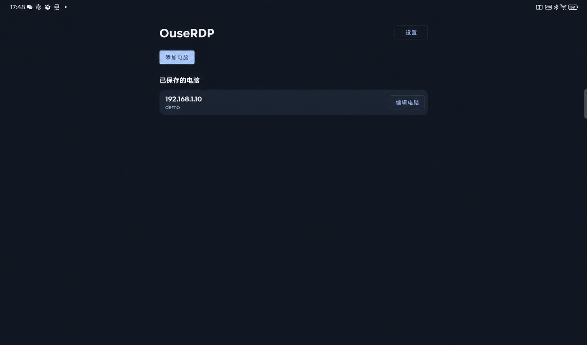
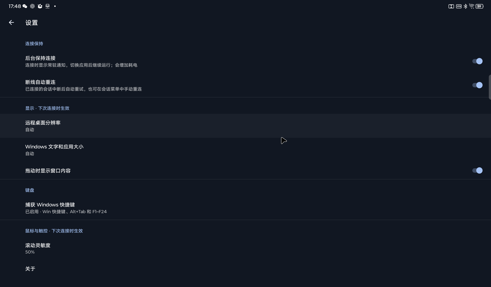

# OuseRDP

让安卓平板，接上你的 Windows 工作台。

OuseRDP 是基于 [iiordanov/remote-desktop-clients](https://github.com/iiordanov/remote-desktop-clients) 的 Android RDP 客户端 Fork，聚焦平板上的触摸、外接键盘和持续连接体验，由 [0use-TE](https://github.com/0use-TE) 维护。

[项目网站](https://0use.net/remote-desktop-clients/) · [使用与构建](#开始使用) · [上游文档](docs/UPSTREAM.md)



## 为平板使用做的改进

- **简单连接**：添加电脑、保存连接配置，点选进入远程桌面。
- **共享文件夹**：在 Windows 打开 `\\tsclient\OuseRDP`，双向复制文件、视频和整个目录；安卓端支持导入、批量保存与取消，见 [使用说明](OuseRDP-app/SHARED_FOLDER.md)。
- **原生触摸**：通过 RDP 触摸通道传递多点触摸，服务端支持时可使用触摸应用；通道未连接时使用兼容操作。
- **键盘路由**：捕获 Win、Alt+Tab 等 Windows 快捷键；Ctrl+Alt+F12 在 Windows 与安卓键盘之间切换，安卓模式显示大字提示。
- **后台保持连接**：切换安卓应用时，通过前台服务维持会话，并提供连接通知。
- **断线恢复**：已连接会话中断后自动重试，网络恢复后继续尝试，也能手动重连。
- **显示与滚动**：调整远程分辨率、Windows 显示缩放和滚动灵敏度；服务端支持时可跟随窗口调整分辨率。本地使用 32 位颜色缓冲，画面更新随屏幕刷新合并。



## 开始使用

1. 在 Windows 电脑开启远程桌面，并确认账户具有远程登录权限。
2. 让平板能够访问电脑的 RDP 地址，可使用局域网或自己的 VPN 网络。
3. 在 OuseRDP 中点击“添加电脑”，填写地址和账户后连接。
4. 使用外接键盘时，在安卓无障碍设置中启用“OuseRDP 键盘快捷键”。

默认键盘控制 Windows。按 **Ctrl+Alt+F12** 交给安卓，再按一次恢复；鼠标与触摸仍用于远程桌面。F1–F12 在部分联想键盘上仍可能触发系统功能，实机适配尚未完成。

Windows 需要支持作为 RDP 服务端的版本，例如专业版或企业版。后台服务与自动重连的行为见 [BACKGROUND.md](OuseRDP-app/BACKGROUND.md)，触摸见 [TOUCH.md](OuseRDP-app/TOUCH.md)，键盘见 [KEYBOARD.md](OuseRDP-app/KEYBOARD.md)。

## 键盘服务恢复

设置中区分未开启、连接中、正常运行和已开启但失联，会话画面不显示无障碍服务提示。异常时可在设置中恢复；可选 ADB 授权后，应用返回前台时会自动尝试恢复自身服务。诊断日志可在设置中导出，详见 [ACCESSIBILITY.md](OuseRDP-app/ACCESSIBILITY.md)。

## 构建

当前本地测试版本为 **0.1.17**，新增 [共享文件夹](OuseRDP-app/SHARED_FOLDER.md)，并保留 [图片复制](OuseRDP-app/CLIPBOARD.md)。收尾范围与验收记录见 [STABILITY.md](OuseRDP-app/STABILITY.md)。使用 JDK 21、Android SDK，以及上游构建流程准备的 FreeRDP 和其他原生依赖；完整依赖准备步骤保留在 [上游构建文档](docs/UPSTREAM.md)。本仓库不包含完整原生依赖产物。

Windows 上先设置 `JAVA_HOME` 与 `ANDROID_HOME`，再构建触摸桥接库和 APK：

```powershell
.\remoteClientLib\src\main\cpp\build-touch.ps1 -NdkRoot C:\path\to\android-ndk
.\gradlew.bat :bVNC:testDebugUnitTest :OuseRDP-app:testDebugUnitTest :OuseRDP-app:assembleDebug
```

APK 输出位于 `OuseRDP-app/build/outputs/apk/debug/`。原生桥接库需要与 FreeRDP 预编译库的版本、ABI 保持一致。

## 网站

介绍页源码位于 [`site/`](site/)。[`pages.yml`](.github/workflows/pages.yml) 使用 GitHub Actions 发布 GitHub Pages；推送网站文件后自动更新，也可手动运行。

## 来源与许可

本 Fork 基于 Iordan Iordanov 及其他贡献者维护的 remote-desktop-clients，保留原有历史、版权与许可声明。OuseRDP 的界面、输入和连接管理改动由本 Fork 维护，相关修改记录见 Git 历史。

整体遵循 [GPL v3](LICENSE)。仓库中部分第三方代码另有 MPL、LGPL 等许可，继续适用其原始声明，详见 [COPYRIGHT-bVNC](COPYRIGHT-bVNC) 及各模块许可文件。
